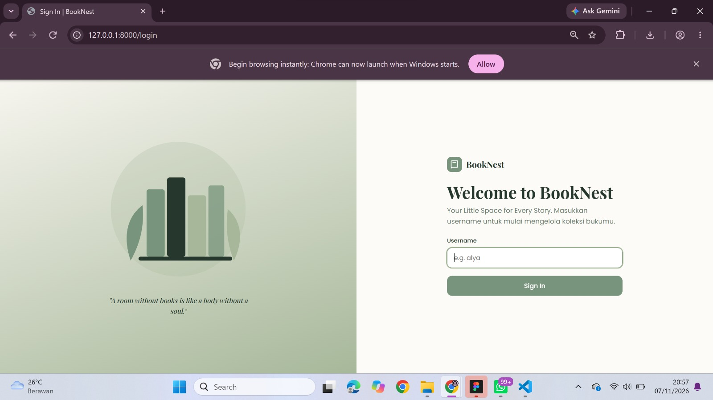
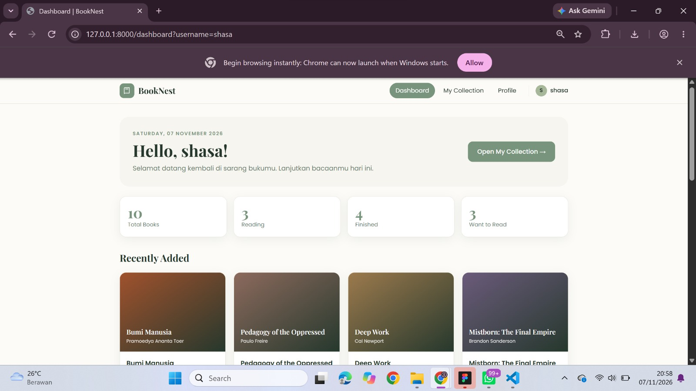
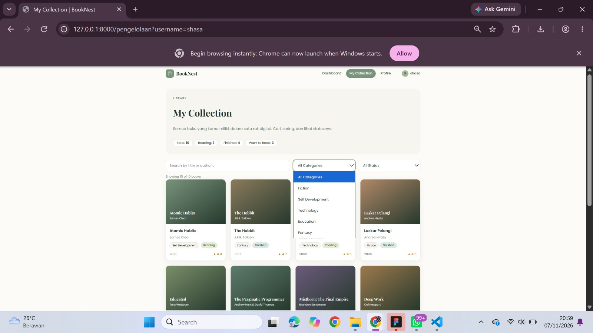
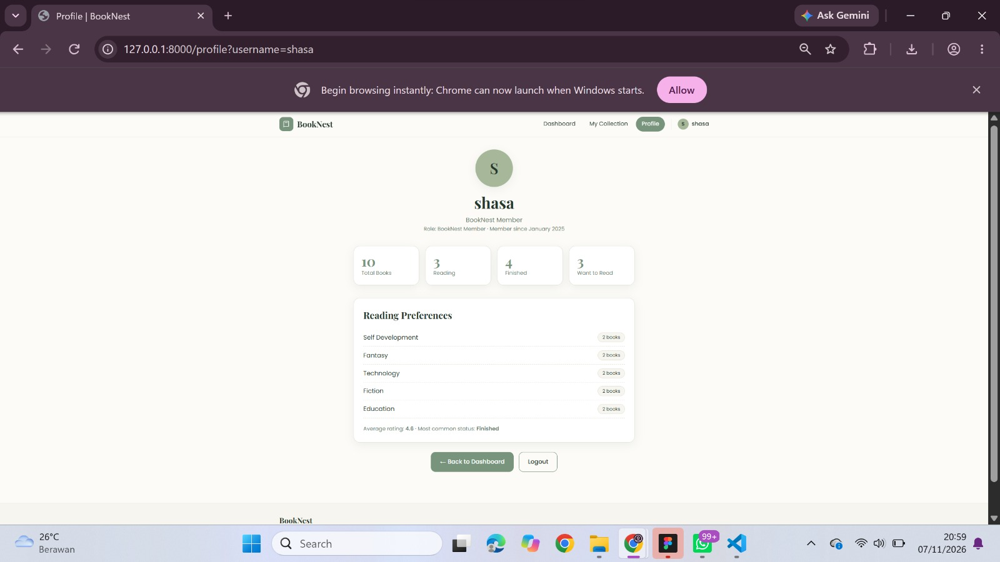

# BookNest

**UTS Pemrograman Web 2026**

- Nama  : Sharifah Nuraini
- NIM   : 252410102052
- Kelas : PWEB B

## Tentang Aplikasi

BookNest adalah aplikasi web pengelolaan koleksi buku pribadi yang dibuat
dengan Laravel (arsitektur MVC) dan Blade Templating. Pengguna dapat
melihat koleksi buku, memantau status membaca, serta mencari dan menyaring
buku berdasarkan kategori dan status.

Tema pengelolaan: **Koleksi buku pribadi (Personal Library)**.

## Fitur

- Login simulasi: username dikirim melalui Request Parameter (`?username=`)
- Dashboard dengan statistik koleksi, buku terbaru, progres baca, dan rekomendasi
- Halaman My Collection dengan search dan filter kategori/status
- Halaman Profile pengguna
- Data buku berasal dari array di Controller (tanpa database)

## Teknologi

Laravel, PHP, Blade Templating, CSS native, JavaScript vanilla.

## Cara Menjalankan

```bash
composer install
copy .env.example .env
php artisan key:generate
php artisan serve
```

Buka http://127.0.0.1:8000

## Screenshot

### Login


### Dashboard


### My Collection


### Profile
